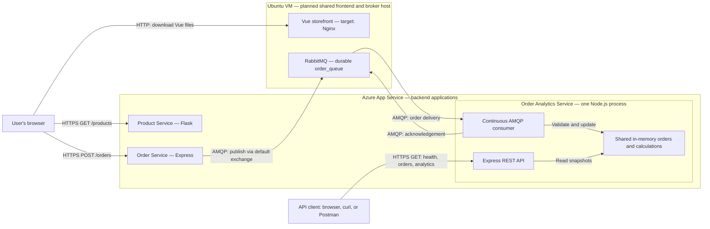

# CST8915 Midterm Project: Order Analytics Service

**Students:** Collin MacLeod, Azubair Dawd, David Yin

**Course:** CST8915 Full-stack Cloud-native Development

**Semester:** Fall 2026

> Review draft — October 18, 2026. Replace every `TODO` and reconcile the planned behavior below with the final source and evidence before submission. This README does not establish that the complete application has passed testing or deployment.

## Introduction

The Order Analytics Service our group has implemented extends the Algonquin Pet Store by processing orders from RabbitMQ and making the resulting data available through a REST API. The intended results include consumed orders, total revenue, average order value, revenue by product, and the top products by quantity sold.

We use Node.js, Express, and amqplib. The code is moving toward one continuous queue consumer and one HTTP server sharing the same in-memory state. The latest reviewed `main` contains the HTTP routes and a receiver module, but does not yet connect them into a working message-to-API flow. An order recorded by analytics represents a consumed order message; it does not establish payment, shipping, or fulfillment.

### Current implementation status

Remote branches fetched and reviewed on October 18, 2026:

| Branch | Reviewed revision | Relationship and scope |
| --- | --- | --- |
| `origin/main` | [`36ce53b`](https://github.com/macl0379/order-analytics-service/commit/36ce53b) | Adds both product analytics routes; also includes the shared-store fix (`3a8ab90`) and deployment workflow update (`a0449c8`). |
| `origin/RabbitMQ-connection` | [`159f601`](https://github.com/macl0379/order-analytics-service/commit/159f601) | Older consumer branch, included in main; main has subsequent fixes absent from this branch. |
| `readme-update` | Documentation working branch | Contains this expanded README; its local application files still reflect the earlier health-only scaffold. |

Unless stated otherwise, implementation details below describe reviewed `origin/main`, not the older application files on this documentation branch. No source branches were merged or application files changed during this review.

| Area | Current evidence |
| --- | --- |
| Runtime and dependencies | Node.js 24.22.0 and npm 11.19.1 were verified locally during setup; Express, amqplib, and dotenv loaded successfully. |
| Startup | `npm start` runs root `index.js`, starting Express but not the receiver. |
| HTTP routes | All five required routes are defined on main and returned HTTP 200 from the deployed hostname during the public check below. |
| State | `orders.js` exports one array; both the entrypoint and receiver import it correctly. No application startup currently invokes the receiver. |
| Receiver | Shared-state imports and callback naming are fixed on main. When invoked manually in a mock, five valid deliveries were stored and acknowledged. |
| Calculations | Empty results, all five known-order results, and a four-product quantity ranking passed isolated checks with mocked Express/AMQP. Input defects remain below. |
| Automated tests | No committed test files or `npm test` script exist in either reviewed source branch. Isolated review checks are described below. |
| Full application | Azure HTTP endpoints respond; live RabbitMQ processing and local/Azure storefront-to-analytics demonstrations remain unverified. |

TODO: Update this table against the final submitted revision; remove superseded draft notes after checking the evidence.

## Demo Video

**Unlisted YouTube video:** TODO: Insert the final video link.

- [Full demo script](DEMO.md) — flexible spoken narration and screen cues for a 6–8 minute presentation.
- [Bullet-point speaking outline](DEMO_OUTLINE.md) — shorter prompts for the same three speaker sections.

Both documents are drafts for group review and rehearsal; products, quantities, and displayed results are chosen during the demonstration.

The presentation will show the design and messaging rationale, local and Azure order-to-analytics demonstrations, and the deployed architecture. All three members will present. Target length: 5–10 minutes; recording tool: OBS Studio. See the [assignment presentation instructions](https://github.com/ramymohamed10/26F_CST8915_Midterm_Project#video-presentation).

## Service Overview and Repositories

| Component | Implementation | Repository | Role |
| --- | --- | --- | --- |
| Storefront | Vue.js | [Storefront source](https://github.com/macl0379/store-front) | Displays products and submits orders. |
| Product Service | Python / Flask | [Product Service — midterm-project branch](https://github.com/yanky65/CST8915-lab02-product-service/tree/midterm-project) | Exposes the product catalog. |
| Order Service | Node.js / Express | [Order Service source](https://github.com/ZubairD25/order-service.git) | Receives orders and publishes messages. |
| Order Analytics Service | Node.js / Express / amqplib | [This repository](https://github.com/macl0379/order-analytics-service) | HTTP routes and an unconnected consumer module; integration remains incomplete. |
| RabbitMQ | Message broker | Not an application repository | Buffers orders in durable `order_queue`. |

The repository links above were confirmed by David. The analytics repository is the group's submission repository. Product Service uses the `midterm-project` branch.

TODO: Record the deployment branch and final commit for each service. This README is being edited on `readme-update`, which is not automatically a deployment branch.

## RabbitMQ Messaging Pattern

### Design direction: one continuous queue consumer

The reused publisher design sends messages through RabbitMQ's default exchange to `order_queue`. `receiver.js` contains a `channel.consume()` callback, but the HTTP entrypoint does not import or call its exported startup function. Once integrated, RabbitMQ will push deliveries while the process remains connected; HTTP requests will read stored results rather than fetch messages from the queue. This follows RabbitMQ's [JavaScript receiving tutorial](https://www.rabbitmq.com/tutorials/tutorial-one-javascript#receiving).

This queue-based design fits the current need: one analytics service must process the orders already published by the existing service. It preserves the publisher's routing and avoids adding a new exchange or a browser connection requirement. Multiple consumers on the same queue would share deliveries, rather than each receiving a copy. Fanout pub/sub would become useful if independent services each needed every order, with a separate queue per service. See RabbitMQ's [work queue](https://www.rabbitmq.com/tutorials/tutorial-two-javascript) and [publish/subscribe](https://www.rabbitmq.com/tutorials/tutorial-three-javascript) explanations.

### Current receiver behavior and integration blockers

Main has fixed the earlier missing module, import/export mismatch, and callback shadowing. Both `index.js` and `receiver.js` now use `const orders = require('./orders')`; `orders.js` exports the array directly. The callback receives `msg`, parses its content, pushes the parsed value into the array, and acknowledges `msg`.

The remaining startup blocker is that `index.js` never imports and calls `receiveOrders()`. A mocked normal startup created no broker connections. Running `node receiver.js` also only loads its exported function; it does not invoke that function. Start one consumer from the normal application entrypoint, after dotenv initialization, and handle startup failure.

There is no payload validation beyond JSON parsing. A mock delivery containing a string `totalPrice` was stored and acknowledged, then broke the summary route. The catch block negatively acknowledges any processing exception without requeue, so the final design should distinguish invalid input from internal failures. Rejection without requeue sends a message to a configured dead-letter exchange or discards it if none is configured. No dead-letter configuration is declared here. See [RabbitMQ rejection behavior](https://www.rabbitmq.com/docs/confirms#negative-acknowledgement-and-requeuing-of-deliveries).

### Intended processing sequence after correction

The independent shared store and `msg` naming now exist. Complete startup wiring, load environment configuration, open a connection/channel, declare matching durable `order_queue`, register one consumer, validate each delivery, update the shared store, and acknowledge only after success. Await consumer registration so startup failures can be handled; the current receiver does not await `channel.consume()`.

The existing receiver relies on the client's default manual-acknowledgement mode; making `{ noAck: false }` explicit is recommended. `prefetch(1)` is also recommended but is not implemented. JSON parsing exists; payload validation does not. Connection/channel error handling, reconnection, consumer cancellation, and graceful shutdown are still absent.

The previously inspected lab publisher requests persistent messages and publisher confirms; verify those properties in the team's current Order Service revision before documenting its deployed behavior. Publisher confirms do not prove analytics processed the order. See [RabbitMQ acknowledgements and confirms](https://www.rabbitmq.com/docs/confirms).

TODO: Correct the integration, then record the final invalid-message and recovery policies. Separate permanently invalid input from internal processing failures instead of discarding both indiscriminately.

### Storage and delivery limits

The shared state is an in-memory array in `orders.js`. Use one application instance and one Node.js process so the routes and consumer share that store. Starting them as separate processes would create separate arrays despite importing the same file. Restarting clears the stored analytics. Acknowledged messages leave the queue and cannot rebuild that lost state. These limits are permitted by the [assignment's storage expectations](https://github.com/ramymohamed10/26F_CST8915_Midterm_Project#storage-and-restart-expectations).

Unacknowledged messages can be redelivered after connection loss. Updating memory and acknowledging a message are separate operations, so this design does not guarantee exactly-once processing. The existing payload has no stable order identifier for reliable deduplication. WebSockets are outside the current design; the required results are exposed through HTTP GET routes.

## Architecture

The following is the intended Azure topology, including the frontend VM alternative. The receiver-to-store path works under mocked delivery on main, but startup does not enable live consumption. Reconcile this diagram with the final code and deployed resources before submission.



The browser calls the backend APIs directly after downloading the frontend. In the completed design, the Order Service publishes to RabbitMQ; analytics processes deliveries independently of HTTP requests and exposes snapshots through REST. A successful order publication may precede its appearance in analytics, so verification should wait for the expected result rather than assume immediate processing.

### Recommended internal structure

Main now keeps HTTP startup/routes in `index.js`, message handling in `receiver.js`, and shared state in `orders.js`. Calculations currently live in route handlers; a separate `analytics.js` is optional, not required. The receiver no longer imports the HTTP entrypoint. No separate consumer process or WebSocket server is needed.

TODO: Import and start the receiver once from `index.js`, await registration, and handle startup/connection failures. Merely exporting the function does not start it.

### Diagram-to-file mapping

This mapping describes reviewed `main`; the boxes in the Azure diagram are responsibilities, not necessarily separate files or processes.

| Diagram component or connection | Responsible file / component | Current state |
| --- | --- | --- |
| Analytics application startup | `index.js`; `package.json` start script | Starts Express only; must also start one receiver. |
| Express REST API and client-to-API connection | `index.js` | All five routes exist and respond publicly; live order processing is unverified. |
| Shared in-memory state | `orders.js` | Both modules import the same array correctly in one process. |
| Calculations | Route handlers in `index.js` | Summary, grouping, and ranking pass known valid mocked inputs; validation and grouping-key defects remain. |
| RabbitMQ-to-consumer connection | `receiver.js` using amqplib | Connection/declaration/consume code exists but is not started by the application. |
| Consumer-to-state connection | `receiver.js` callback plus `orders.js` | Five manually delivered mock orders reached the same array read by routes; input validation is absent. |
| Consumer-to-RabbitMQ acknowledgement | `receiver.js` | Five valid mock deliveries produced five ACKs; malformed JSON produced a NACK without requeue. |
| Frontend and browser API requests | Team storefront repository | Outside this analytics repository; deployment still needs documented evidence. |
| Product catalog and order publisher | Team Product and Order repositories | Separate backend services; their deployment does not implement analytics consumption. |
| RabbitMQ queue and VM/Nginx hosting | Broker and hosting configuration | Infrastructure responsibilities; declaring a queue does not provision the VM or deploy the applications. |

### Frontend hosting exception

Static Web Apps is unavailable in the team's Azure for Students subscription. David reports that the instructor-approved frontend VM alternative from Lab 3 also applies to this midterm. The intended frontend host is Nginx on the RabbitMQ VM; backend applications remain on App Service.

TODO: Retain the instructor approval as supporting evidence, confirm whether the deployed frontend uses Nginx or the development server, and record the actual frontend CI/CD procedure. The hosting exception alone does not establish an exception to frontend CI/CD.

## API Contract

These are the [required routes](https://github.com/ramymohamed10/26F_CST8915_Midterm_Project#part-1-build-the-order-analytics-service). Reviewed `main` defines all five; the documentation branch's local entrypoint still defines only `/health`.

| Method | Path | Response content | Status in this revision |
| --- | --- | --- | --- |
| GET | `/health` | Service status | Route defined; broker status not checked. |
| GET | `/orders` | All consumed orders since startup | Defined on `main`; no running receiver populates its array. |
| GET | `/analytics/summary` | `totalOrders`, `totalRevenue`, `averageOrderValue` | Defined on `main`; calculations checked with injected valid data only. |
| GET | `/analytics/products` | `productName`, `orderCount`, `totalRevenue` per product | Defined on main; passed known-order mocked results; grouping-key collision remains. |
| GET | `/analytics/top-products` | Up to three `productName`, `totalQuantity` entries | Defined on main; quantity ranking and top-three limit passed mocks; grouping-key collision remains. |

The current health handler returns:

```json
{
  "status": "healthy",
  "service": "order-analytics-service"
}
```

This response currently describes only the HTTP handler; it does not verify RabbitMQ connectivity. TODO: Update this documentation if health semantics change.

### Order message and calculation rules

Example message for two units of Dog Food:

```json
{
  "product": { "id": 1, "name": "Dog Food", "price": 19.99 },
  "quantity": 2,
  "totalPrice": 39.98
}
```

The summary route currently counts array entries, sums `order.totalPrice`, divides by order count, and rounds the returned revenue and average with `toFixed(2)` followed by `Number(...)`. Its empty result is all zero. It does not multiply a line total by quantity again.

These calculations use JavaScript floating-point arithmetic, not integer cents. With injected valid numeric orders, the five-order example below produced the expected summary. With an injected string total, the route threw `TypeError`; a missing total produced non-finite results serialized as JSON `null`. The receiver currently performs no schema or numeric validation to prevent these cases.

Product grouping counts array entries and sums revenue by name. Top-products sums quantity by name, sorts descending, and returns up to three. Both currently group into a plain `{}` with a truthiness check; a product named `constructor` collides with an inherited property and disappears from both outputs in a mock. Use a `Map` or a null-prototype dictionary to handle arbitrary names correctly.

Proposed next rules: require a product object, finite numeric price/total, and positive integer quantity; verify line-total consistency; accumulate money in integer cents. TODO: Finalize rounding, invalid-input, name-grouping, and ranking-tie policies and test them against the final code.

## Configuration and Local Startup

### Prerequisites

Use Node.js 24 LTS and npm. RabbitMQ plus the other three application services are needed for the complete integration run. On Windows, `npm.cmd` avoids ambiguity with PowerShell's npm script wrapper. Node installed on Windows does not configure a separate Ubuntu VM.

| Variable | Current behavior / intended use |
| --- | --- |
| `PORT` | Implemented in `index.js`; defaults to `4000`. Use the platform-provided port on App Service. |
| `RABBITMQ_CONNECTION_STRING` | Read at module load by `receiver.js`, with a fallback URL. Currently unreachable through `npm start` because the entrypoint does not load/start the receiver. |

`dotenv` is loaded by the entrypoint, so a local ignored `.env` can provide configuration. Keep that initialization before loading modules that read environment variables at import time. The chosen broker variable is now `RABBITMQ_CONNECTION_STRING`, not the earlier proposed `RABBITMQ_URL`. Its value has this shape: `amqp://<user>:<password>@<host>:5672/<vhost>`. Use the same broker/vhost as the publisher and keep real credentials out of Git. On App Service, provide it as an application setting after correcting startup integration.

### Windows PowerShell — current HTTP scaffold

Run from the cloned analytics repository:

```powershell
node --version
npm.cmd ci
$env:PORT = '4000'
npm.cmd start
```

In a second PowerShell terminal:

```powershell
Invoke-RestMethod 'http://localhost:4000/health'
```

### Ubuntu Bash — current HTTP scaffold

Run from the cloned analytics repository:

```bash
node --version
npm ci
PORT=4000 npm start
```

In a second Ubuntu terminal:

```bash
curl --fail http://localhost:4000/health
```

Stop the foreground process with Ctrl+C. These commands exercise HTTP startup only, not message consumption. On reviewed `main`, `/orders` and `/analytics/summary` can also be requested, but an empty result does not establish a working receiver. TODO: Add the verified broker and full-stack startup procedure after the integration defects are fixed. Do not start an extra standalone consumer against the shared queue to compensate for missing application wiring.

## Verification and Evidence

### Known-order acceptance example

The following is the acceptance dataset. On main `36ce53b`, all five orders were delivered through the manually invoked receiver with mocked AMQP and Express; orders, summary, grouping, and ranking matched the expectations below, with five ACKs and no NACKs. These orders have not passed through a real broker or deployed consumer. For integration, use a fresh dedicated test broker/vhost or an explicitly recorded baseline; do not purge a shared queue. Start analytics once, then submit these orders through the storefront.

| Order | Product | Unit price | Quantity | Expected line total |
| --- | --- | --- | --- | --- |
| 1 | Dog Food | 19.99 | 1 | 19.99 |
| 2 | Cat Food | 34.99 | 2 | 69.98 |
| 3 | Dog Food | 19.99 | 3 | 59.97 |
| 4 | Bird Seeds | 10.99 | 5 | 54.95 |
| 5 | Cat Food | 34.99 | 1 | 34.99 |

Expected summary: **5 orders**, **239.88 revenue**, **47.98 average order value**.

| Product | Order count | Revenue | Total quantity |
| --- | --- | --- | --- |
| Bird Seeds | 1 | 54.95 | 5 |
| Dog Food | 2 | 79.96 | 4 |
| Cat Food | 2 | 104.97 | 3 |

The top-products ranking should therefore be Bird Seeds, Dog Food, then Cat Food. Also verify an empty dataset, malformed JSON, invalid values, rounding, and acknowledgement behavior. Automated tests support these checks but do not replace a real browser-to-broker integration run.

### Evidence record

| Check | Result currently supported | Evidence to add |
| --- | --- | --- |
| Local dependency setup | Node 24.22.0 and module loading previously verified | Capture runtime and final source revision. |
| Reviewed source syntax | `index.js` and `receiver.js` parsed for both reviewed revisions | This does not prove imports or application startup succeed. |
| HTTP route callbacks and shared store | Main `36ce53b`: empty data responses and five-order results matched expectations; valid deliveries produced 5 ACKs, 0 NACKs, 5 stored orders after manual receiver invocation | Verify the same flow through a real broker and HTTP client. |
| Normal startup | Mocked `npm start` entrypoint created no broker connection; receiver is not called | Wire startup and verify one active consumer. |
| Quantity ranking | Four-product mock returned only the top three by quantity, excluding a high-revenue/low-quantity product | Retain a focused regression test. |
| Grouping-key collision | One acknowledged product named `constructor` remained in `/orders` but disappeared from products/top-products outputs | Use safe map keys and add a regression test. |
| Invalid totals | Main's summary threw `TypeError` for a string total; missing total serialized revenue/average as `null` | Add validation and regression checks. |
| Automated analytics tests | No committed tests or test script in reviewed branches; the checks above were isolated review probes | Commit focused tests and record their command and results. |
| Local full-stack run | Pending | Browser request JSON/types, broker state, all analytics responses, source commits. |
| Product Service on Azure | `/products` returned HTTP 200 on October 18, 2026 | [Deployment run](https://github.com/yanky65/CST8915-lab02-product-service/actions/runs/39156213130); recheck before recording. |
| Analytics HTTP on Azure | October 18, 2026, approximately 17:12 EDT: all five GET endpoints returned HTTP 200 JSON; `/orders`, products and top-products were `[]`; summary was all zero | HTTP operation only; no order was submitted and no broker processing was verified. |
| Storefront correction | David reported the URL configuration issue resolved | Capture a successful current browser catalog request. |
| Azure order-to-analytics run | Pending | Same known-order checks against deployed services and matching revisions. |

TODO: Link the final screenshots/logs or video timestamps from this repository. A successful workflow alone does not prove that the running service processes orders correctly. Record when checks occurred; public addresses and resources can change.

## Azure Deployment

**Resource group:** `CST8915-Midterm-Project`

**Subscription:** Azure for Students

| Component | Hosting / address currently recorded | Verification status |
| --- | --- | --- |
| Product Service | App Service `product-service-mp`; [GET /products](https://product-service-mp-e8cmescacqfnc2ay.swedencentral-01.azurewebsites.net/products) | Verified October 18; David reported upgrading F1 to B1 after quota exhaustion. |
| Order Service | App Service; [recorded base URL](https://order-service-mp-exgrfra3dufjddd7.swedencentral-01.azurewebsites.net) | End-to-end verification pending. |
| Storefront | [Reported VM address](http://51.12.48.232:8080/) | David reports URL fix; final hosting/CI/CD evidence pending. |
| RabbitMQ | Ubuntu VM; AMQP connection kept in backend settings | TODO: Record VM resource name and network configuration without credentials. |
| Analytics | App Service target `order-analytics-service`; [GET /health](https://order-analytics-service-hqdma3cmhadyhka2.swedencentral-01.azurewebsites.net/health) | All five GET endpoints returned HTTP 200 with empty data at approximately 17:12 EDT on October 18. Runtime/scale settings and live consumption remain unverified. |

The analytics workflow at `.github/workflows/main_order-analytics-service.yml` triggers on pushes to main and manual dispatch, builds with Node 24, and targets `order-analytics-service` using Azure OIDC secret references. It runs `npm install` and optional build/test scripts. There is no test script in the reviewed manifest, so `--if-present` can skip testing without failing. Recommend `npm ci` and actual test assertions before treating a green build as verification. Workflow-run success, Azure runtime settings, and the deployed commit were not checked during the public HTTP probe.

For analytics deployment, package the root `package.json`, lockfile, `index.js`, and any implemented modules. Install dependencies on the deployment platform and start with `npm start`. Supply the final broker setting through App Service configuration and ensure the VM permits the application's AMQP traffic. TODO: Record actual runtime, settings, identity/workflow branch, and deployment evidence after validation.

Frontend `VUE_APP_PRODUCT_SERVICE_URL` and `VUE_APP_ORDER_SERVICE_URL` values must include `https://` for these App Service APIs. Supply them before starting the Vue development server or building the production bundle. The team corrected missing URL schemes during setup. See [Vue CLI environment configuration](https://cli.vuejs.org/guide/mode-and-env.html).

## First Four Twelve-Factor Principles

The [Twelve-Factor App](https://12factor.net/) provides the basis for these implementation checks.

| Factor | Application to this project | Current status |
| --- | --- | --- |
| I. Codebase | Separate analytics Git repository with reviewed changes. | Repository exists. |
| II. Dependencies | Declare libraries in `package.json`; reproduce installs using the lockfile. | Manifest and lockfile exist; direct dependency specifications agree. |
| III. Config | Supply the port and broker connection through environment variables. | Both settings exist in source; receiver startup remains disconnected. |
| IV. Backing services | Treat RabbitMQ as an attached service selected through configuration. | Connection logic exists in `receiver.js`; working integration remains unverified. |

## Team Contributions

Record completed work rather than the earlier proposed role split. All members are expected to understand the complete system and present their contributions.

| Member | Work currently recorded | Final contribution evidence |
| --- | --- | --- |
| Collin MacLeod | Git history attributes the receiver work (`3276bc4`, `1859913`) and PR #3 merge to Collin. Receiver source acknowledges ChatGPT assistance. | TODO: Confirm completed scope, add PR links and presentation segment, and describe student evaluation of assisted code. |
| Azubair Dawd | Git history attributes `/orders` (`55e2ec8`), summary (`2b1f965`), and array export (`2881c29`) to Azubair. | TODO: Confirm completed scope and link relevant PRs and presentation segment. |
| David Yin (`yanky65`) | Configured Product Service deployment, addressed hosting quota and deployment branch settings, and coordinated setup/troubleshooting. | TODO: Add relevant commits/PRs and presentation segment; reconcile with team review. |

TODO: Confirm name spelling, GitHub usernames, and each member's actual contributions. This draft does not assign ownership or attribute unidentified teammates' work.

## AI Assistance and Student Review

David used OpenAI Codex to assist with assignment analysis, inspection of reused lab code, architecture research, Node.js setup checks, deployment/frontend troubleshooting, proposed acceptance data, and drafting this README. Codex fetched source branches and ran isolated Express/AMQP checks, including main `36ce53b` with all five routes, manually delivered orders, numeric-input failure, and a grouping-name collision. It also checked the five public analytics GET endpoints, which returned HTTP 200 with empty data. No orders were submitted, no live broker processing was verified, and no application source was changed during this review. Codex consulted the assignment and official RabbitMQ documentation.

`receiver.js` separately states that its code was developed with ChatGPT and comments were added by Collin MacLeod. TODO: Collin should expand that disclosure with the actual assistance, student modifications, verification, and citation. This record does not infer AI use for other code without evidence.

`index.js` now also acknowledges ChatGPT assistance and states that all code was reviewed, tested, and understood. TODO: Reconcile that statement with actual student review and recorded verification before submission; the source comment alone does not establish completion.

The code and deployment claims above were separated from proposed behavior. The group must independently review and modify this draft, verify calculations and application behavior, and explain its design decisions. Student review has not been asserted complete.

**AI citation:** OpenAI. (2026, October 18). *Codex assistance with the CST8915 midterm project* [AI-assisted analysis, troubleshooting, and documentation]. Private working session with David Yin; no public transcript link is provided. TODO: Adapt to any course-specific citation format, add later AI use, and record the group's actual evaluation and changes.

TODO: Before submission, document what the students corrected, rejected, tested, or rewrote, and disclose any additional tools used by other members. Follow the [assignment's academic-integrity requirements](https://github.com/ramymohamed10/26F_CST8915_Midterm_Project#academic-integrity).

## Submission Review

Use the [current assignment](https://github.com/ramymohamed10/26F_CST8915_Midterm_Project) and Brightspace as the authority. The published due date is October 23, 2026; confirm the exact Eastern time in Brightspace.

- [ ] Replace all `TODO` entries and reconcile this draft with the final code and deployment.
- [ ] Confirm the analytics repository is private and `ramymohamed10` has collaborator access.
- [ ] Include source, deployment evidence, final diagram, working video link, and actual contributions.
- [ ] Verify local and Azure demonstrations and the AI disclosure.
- [ ] Merge reviewed documentation into the revision being submitted and submit the repository URL through Brightspace.
- [ ] If the repository changes after submission, follow the assignment's resubmission instructions.
