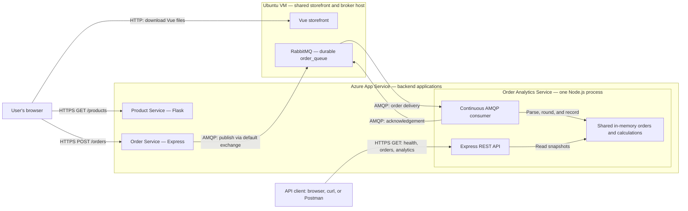

# CST8915 Midterm Project: Order Analytics Service

**Students:** Collin MacLeod, Azubair Dawd, David Yin

**Course:** CST8915 Full-stack Cloud-native Development

**Semester:** Fall 2026

> Review draft — October 18, 2026. Replace every `TODO` and reconcile the planned behavior below with the final source and evidence before submission. This README does not establish that the complete application has passed testing or deployment.

## Introduction

The Order Analytics Service our group has implemented extends the Algonquin Pet Store by processing orders from RabbitMQ and making the resulting data available through a REST API. The intended results include consumed orders, total revenue, average order value, revenue by product, and the top products by quantity sold.

We use Node.js, Express, and amqplib. The service starts a continuous queue consumer and an HTTP server sharing the same in-memory array. The normal entrypoint now calls the receiver; the earlier disconnected-startup description has been superseded. An order recorded by analytics represents a consumed order message; it does not establish payment, shipping, or fulfillment.

### Current implementation status

Local main reviewed at [`aec49d7`](https://github.com/macl0379/order-analytics-service/commit/aec49d7) on October 18, 2026. Consumer startup was added in `8172609`; monetary presentation was normalized in `7d368ac`. Documentation edits may be newer than these commits. The actual deployed commit has not been independently identified.

| Area | Current evidence |
| --- | --- |
| Startup and state | `npm start` runs `index.js`, which calls `receiveOrders()`. Both modules import the array exported by `orders.js`. |
| API | All five required routes exist. All returned HTTP 200 in the Azure checks recorded below. |
| Live data | At approximately 17:32 EDT on October 18, the deployed API held six orders; independent decimal arithmetic matched revenue 992.61 and average 165.44. This was an observed dataset, not a required demo fixture. |
| Rounding | Receiver rounds numeric line totals before storage. Mocked checks verified the observed floating-point examples without changing quantities or ACK behavior. |
| Local demonstration | Complete local storefront-to-analytics evidence remains to be recorded or supplied by the group. |
| Azure demonstration | Populated API responses were verified; the assistant did not submit or trace those orders. Record a controlled deployed storefront-to-analytics demonstration. |
| Automated tests | No committed test script exists. Automated tests are recommended, not separately required by the assignment. |
| Submission | Video link, final contributions, student AI evaluation, access confirmation, and final evidence still contain review items. |

TODO: Reconcile the final submitted revision and deployed revision, then replace remaining submission placeholders with actual evidence.

## Demo Video

**Unlisted YouTube video:** TODO: Insert the final video link.

- [Full demo script](DEMO.md) — flexible spoken narration and screen cues for a 6–8 minute presentation.
- [Bullet-point speaking outline](DEMO_OUTLINE.md) — shorter prompts for the same three speaker sections.

Both documents are drafts for group review and rehearsal; products, quantities, and displayed results are chosen during the demonstration.

The presentation will show the design and messaging rationale, local and Azure order-to-analytics demonstrations, and the deployed architecture. All three members will present. Target length: 5–10 minutes; recording tool: OBS Studio. See the [assignment presentation instructions](https://github.com/ramymohamed10/26F_CST8915_Midterm_Project#video-presentation).

## Service Overview and Repositories

| Component | Implementation | Repository | Role |
| --- | --- | --- | --- |
| Storefront | Vue.js | [Storefront source](https://github.com/macl0379/store-front) | Displays products and submits orders. |
| Product Service | Python / Flask | [Product Service — midterm-project branch](https://github.com/yanky65/CST8915-lab02-product-service/tree/midterm-project) | Exposes the product catalog. |
| Order Service | Node.js / Express | [Order Service source](https://github.com/ZubairD25/order-service.git) | Receives orders and publishes messages. |
| Order Analytics Service | Node.js / Express / amqplib | [This repository](https://github.com/macl0379/order-analytics-service) | Starts the consumer, stores received orders, and exposes the analytics API. |
| RabbitMQ | Message broker | Not an application repository | Buffers orders in durable `order_queue`. |

The repository links above were confirmed by David. The analytics repository is the group's submission repository. Product Service uses the `midterm-project` branch.

TODO: Record the deployment branch and final commit for each service. The documentation branch has been merged into main; verify that the final recording and submission use the intended revisions.

## RabbitMQ Messaging Pattern

### Design direction: one continuous queue consumer

The reused publisher design sends messages through RabbitMQ's default exchange to `order_queue`. `index.js` imports and calls the receiver's startup function. RabbitMQ pushes deliveries to its `channel.consume()` callback while connected; HTTP requests read stored results rather than fetch messages from the queue. This follows RabbitMQ's [JavaScript receiving tutorial](https://www.rabbitmq.com/tutorials/tutorial-one-javascript#receiving).

This queue-based design fits the current need: one analytics service must process the orders already published by the existing service. It preserves the publisher's routing and avoids adding a new exchange or a browser connection requirement. Multiple consumers on the same queue would share deliveries, rather than each receiving a copy. Fanout pub/sub would become useful if independent services each needed every order, with a separate queue per service. See RabbitMQ's [work queue](https://www.rabbitmq.com/tutorials/tutorial-two-javascript) and [publish/subscribe](https://www.rabbitmq.com/tutorials/tutorial-three-javascript) explanations.

### Current processing behavior

Both modules import `orders.js`, which exports the shared array directly. The receiver parses each JSON delivery, rounds its numeric `totalPrice` to cents, stores the order, and acknowledges the delivery. Processing exceptions follow the existing NACK-without-requeue path. Without a configured dead-letter destination, rejected messages are discarded.

The normal entrypoint now starts the receiver and exits on a rejected startup promise. HTTP startup is not gated on consumer registration, and `channel.consume()` is not awaited. These are reliability considerations rather than a reason to claim the consumer is still disconnected.

### Recommendations, not extra assignment requirements

Automated tests, explicit prefetch, stricter payload validation, safe dictionary keys, connection-aware readiness, reconnection, graceful shutdown, integer-cent aggregation, and deterministic tie handling are engineering recommendations. They are not separately mandated features. The group has chosen to keep scope small and apply the rounding change; do not describe broader proposed fixes as implemented.

The application must still produce accurate required results and demonstrate normal continuous consumption. Existing health reports HTTP service status rather than a detailed broker readiness check. Reconnection and exactly-once processing are not claimed.

### Storage and delivery limits

The shared state is an in-memory array in `orders.js`. Use one application instance and one Node.js process so the routes and consumer share that store. Starting them as separate processes would create separate arrays despite importing the same file. Restarting clears the stored analytics. Acknowledged messages leave the queue and cannot rebuild that lost state. These limits are permitted by the [assignment's storage expectations](https://github.com/ramymohamed10/26F_CST8915_Midterm_Project#storage-and-restart-expectations).

Unacknowledged messages can be redelivered after connection loss. Updating memory and acknowledging a message are separate operations, so this design does not guarantee exactly-once processing. The existing payload has no stable order identifier for reliable deduplication. WebSockets are outside the current design; the required results are exposed through HTTP GET routes.

## Architecture

David confirmed on October 18 that the storefront and RabbitMQ share one Ubuntu VM. The diagram reflects that hosting arrangement and the application's communication design; verify final resource names before recording. The frontend server software has not been independently confirmed.



The browser calls the backend APIs directly after downloading the frontend. In the completed design, the Order Service publishes to RabbitMQ; analytics processes deliveries independently of HTTP requests and exposes snapshots through REST. A successful order publication may precede its appearance in analytics, so verification should wait for the expected result rather than assume immediate processing.

### Recommended internal structure

Main now keeps HTTP startup/routes in `index.js`, message handling in `receiver.js`, and shared state in `orders.js`. Calculations currently live in route handlers; a separate `analytics.js` is optional, not required. The receiver no longer imports the HTTP entrypoint. No separate consumer process or WebSocket server is needed.

The receiver is now called from `index.js`. Awaiting registration and expanding recovery handling remain optional improvements; the current startup behavior is described above.

### Diagram-to-file mapping

This mapping describes reviewed `main`; the boxes in the Azure diagram are responsibilities, not necessarily separate files or processes.

| Diagram component or connection | Responsible file / component | Current state |
| --- | --- | --- |
| Analytics application startup | `index.js`; `package.json` start script | Starts the receiver and Express; HTTP does not wait for consumer registration. |
| Express REST API and client-to-API connection | `index.js` | All five routes respond publicly; six stored orders and matching calculations were observed. |
| Shared in-memory state | `orders.js` | Both modules import the same array correctly in one process. |
| Calculations | Route handlers in `index.js` | Summary, grouping, and ranking pass known valid mocked inputs; validation and grouping-key defects remain. |
| RabbitMQ-to-consumer connection | `receiver.js` using amqplib | Called by the entrypoint; uses matching durable `order_queue`. |
| Consumer-to-state connection | `receiver.js` callback plus `orders.js` | Five manually delivered mock orders reached the same array read by routes; input validation is absent. |
| Consumer-to-RabbitMQ acknowledgement | `receiver.js` | Five valid mock deliveries produced five ACKs; malformed JSON produced a NACK without requeue. |
| Frontend and browser API requests | Team storefront repository | Outside this analytics repository; deployment still needs documented evidence. |
| Product catalog and order publisher | Team Product and Order repositories | Separate backend services; their deployment does not implement analytics consumption. |
| RabbitMQ queue and shared VM hosting | Broker and hosting configuration | Storefront and RabbitMQ share the VM; record actual frontend serving and deployment details. |

### Frontend hosting exception

Static Web Apps is unavailable in the team's Azure for Students subscription. David reports that the instructor-approved frontend VM alternative from Lab 3 also applies to this midterm. David confirmed the frontend shares the RabbitMQ VM; backend applications remain on App Service. The actual frontend server software still needs to be recorded.

TODO: Retain the instructor approval as supporting evidence, confirm whether the deployed frontend uses Nginx or the development server, and record the actual frontend CI/CD procedure. The hosting exception alone does not establish an exception to frontend CI/CD.

## API Contract

These are the [required routes](https://github.com/ramymohamed10/26F_CST8915_Midterm_Project#part-1-build-the-order-analytics-service). Current main defines all five.

| Method | Path | Response content | Status in this revision |
| --- | --- | --- | --- |
| GET | `/health` | Service status | Route defined; broker status not checked. |
| GET | `/orders` | All consumed orders since startup | Defined and populated in the observed Azure dataset. |
| GET | `/analytics/summary` | `totalOrders`, `totalRevenue`, `averageOrderValue` | Defined; mocked fixture and independent arithmetic on the observed live dataset matched. |
| GET | `/analytics/products` | `productName`, `orderCount`, `totalRevenue` per product | Defined on main; passed known-order mocked results; grouping-key collision remains. |
| GET | `/analytics/top-products` | Up to three `productName`, `totalQuantity` entries | Defined on main; quantity ranking and top-three limit passed mocks; grouping-key collision remains. |

The current health handler returns:

```json
{
  "status": "healthy",
  "service": "order-analytics-service"
}
```

This response currently describes only the HTTP handler; it does not verify RabbitMQ connectivity. TODO: Update this documentation if health semantics change.

### Order message and calculation rules

Example message for two units of Dog Food:

```json
{
  "product": { "id": 1, "name": "Dog Food", "price": 19.99 },
  "quantity": 2,
  "totalPrice": 39.98
}
```

The summary route currently counts array entries, sums `order.totalPrice`, divides by order count, and rounds the returned revenue and average with `toFixed(2)` followed by `Number(...)`. Its empty result is all zero. It does not multiply a line total by quantity again.

These calculations use JavaScript floating-point arithmetic, not integer-cent accumulation. The receiver now normalizes numeric line totals with `Number(order.totalPrice.toFixed(2))` before storage; summary and grouped revenue also format their returned values to cents. No broader schema-validation change is claimed. Earlier invalid-input probes predate this rounding change.

Product grouping counts array entries and sums revenue by name. Top-products sums quantity by name, sorts descending, and returns up to three. Both currently group into a plain `{}` with a truthiness check; a product named `constructor` collides with an inherited property and disappears from both outputs in a mock. Use a `Map` or a null-prototype dictionary to handle arbitrary names correctly.

Optional future work includes stricter input checks, safe grouping keys, integer-cent accumulation, and explicit tie rules. These proposals do not prescribe extra submission features; document only the behavior retained in the final code.

## Configuration and Local Startup

### Prerequisites

Use Node.js 24 LTS and npm. RabbitMQ plus the other three application services are needed for the complete integration run. On Windows, `npm.cmd` avoids ambiguity with PowerShell's npm script wrapper. Node installed on Windows does not configure a separate Ubuntu VM.

| Variable | Current behavior / intended use |
| --- | --- |
| `PORT` | Implemented in `index.js`; defaults to `4000`. Use the platform-provided port on App Service. |
| `RABBITMQ_CONNECTION_STRING` | Read by `receiver.js` when loaded by the entrypoint; controls the broker connection, with a localhost fallback. |

`dotenv` is loaded by the entrypoint, so a local ignored `.env` can provide configuration. Keep that initialization before loading modules that read environment variables at import time. The chosen broker variable is now `RABBITMQ_CONNECTION_STRING`, not the earlier proposed `RABBITMQ_URL`. Its value has this shape: `amqp://<user>:<password>@<host>:5672/<vhost>`. Use the same broker/vhost as the publisher and keep real credentials out of Git. On App Service, provide it as an application setting after correcting startup integration.

### Windows PowerShell

Run from the cloned analytics repository:

```powershell
node --version
npm.cmd ci
$env:PORT = '4000'
npm.cmd start
```

In a second PowerShell terminal:

```powershell
Invoke-RestMethod 'http://localhost:4000/health'
```

### Ubuntu Bash

Run from the cloned analytics repository:

```bash
node --version
npm ci
PORT=4000 npm start
```

In a second Ubuntu terminal:

```bash
curl --fail http://localhost:4000/health
```

Stop the foreground process with Ctrl+C. These commands start the API and request a broker connection. Supply the actual RabbitMQ connection string through an ignored `.env` or the process environment; the publisher and consumer must use the same broker/vhost. The full local demonstration also requires Product Service, Order Service, and the storefront. Do not run competing analytics consumers against the same test queue.

## Verification and Evidence

### Optional known-order verification example

The following is an optional verification dataset, not a required submission or video sequence. Any suitable orders may be used to demonstrate correct results. On main `36ce53b`, all five orders were delivered through the manually invoked receiver with mocked AMQP and Express; orders, summary, grouping, and ranking matched the expectations below, with five ACKs and no NACKs. These orders have not passed through a real broker or deployed consumer. For integration, use a fresh dedicated test broker/vhost or an explicitly recorded baseline; do not purge a shared queue. Start analytics once, then submit these orders through the storefront.

| Order | Product | Unit price | Quantity | Expected line total |
| --- | --- | --- | --- | --- |
| 1 | Dog Food | 19.99 | 1 | 19.99 |
| 2 | Cat Food | 34.99 | 2 | 69.98 |
| 3 | Dog Food | 19.99 | 3 | 59.97 |
| 4 | Bird Seeds | 10.99 | 5 | 54.95 |
| 5 | Cat Food | 34.99 | 1 | 34.99 |

Expected summary: **5 orders**, **239.88 revenue**, **47.98 average order value**.

| Product | Order count | Revenue | Total quantity |
| --- | --- | --- | --- |
| Bird Seeds | 1 | 54.95 | 5 |
| Dog Food | 2 | 79.96 | 4 |
| Cat Food | 2 | 104.97 | 3 |

The top-products ranking should therefore be Bird Seeds, Dog Food, then Cat Food. Also verify an empty dataset, malformed JSON, invalid values, rounding, and acknowledgement behavior. Automated tests support these checks but do not replace a real browser-to-broker integration run.

### Evidence record

| Check | Result currently supported | Evidence to add |
| --- | --- | --- |
| Local dependency setup | Node 24.22.0 and module loading previously verified | Capture runtime and final source revision. |
| Reviewed source syntax | `index.js` and `receiver.js` parsed for both reviewed revisions | This does not prove imports or application startup succeed. |
| HTTP route callbacks and shared store | Main `36ce53b`: empty data responses and five-order results matched expectations; valid deliveries produced 5 ACKs, 0 NACKs, 5 stored orders after manual receiver invocation | Verify the same flow through a real broker and HTTP client. |
| Normal startup | Review of `8172609` confirmed the entrypoint calls the receiver; HTTP starts before registration finishes | Record an active consumer during the actual demo; readiness improvements are optional. |
| Quantity ranking | Four-product mock returned only the top three by quantity, excluding a high-revenue/low-quantity product | Retain a focused regression test. |
| Grouping-key collision | One acknowledged product named `constructor` remained in `/orders` but disappeared from products/top-products outputs | Use safe map keys and add a regression test. |
| Historical invalid-input probes | Before the rounding change, string/missing totals broke summary behavior; these probes are not a claim about the updated receiver's acceptance behavior | Optional focused validation/regression checks. |
| Automated analytics tests | No committed test script; the checks above were isolated review probes | Optional; record actual results if tests are added. |
| Local full-stack run | Pending | Browser request JSON/types, broker state, all analytics responses, source commits. |
| Product Service on Azure | `/products` returned HTTP 200 on October 18, 2026 | [Deployment run](https://github.com/yanky65/CST8915-lab02-product-service/actions/runs/39156213130); recheck before recording. |
| Analytics HTTP on Azure | October 18, 2026, approximately 17:12 EDT: all five GET endpoints returned HTTP 200 JSON; `/orders`, products and top-products were `[]`; summary was all zero | HTTP operation only; no order was submitted and no broker processing was verified. |
| Populated analytics on Azure | October 18, approximately 17:32 EDT: six orders, revenue 992.61, average 165.44. Decimal recalculation matched; grouping and quantity totals were consistent | Assistant did not submit/trace those orders; record a controlled storefront demonstration. |
| Rounding followup | Receiver's one-line change normalized observed floating-point examples in a mock, preserving numeric output and ACK behavior | Confirm presentation in the deployed revision used for recording. |
| Storefront correction | David reported the URL configuration issue resolved | Capture a successful current browser catalog request. |
| Azure order-to-analytics run | Pending | Same known-order checks against deployed services and matching revisions. |

TODO: Link the final screenshots/logs or video timestamps from this repository. A successful workflow alone does not prove that the running service processes orders correctly. Record when checks occurred; public addresses and resources can change.

## Azure Deployment

**Resource group:** `CST8915-Midterm-Project`

**Subscription:** Azure for Students

| Component | Hosting / address currently recorded | Verification status |
| --- | --- | --- |
| Product Service | App Service `product-service-mp`; [GET /products](https://product-service-mp-e8cmescacqfnc2ay.swedencentral-01.azurewebsites.net/products) | Verified October 18; David reported upgrading F1 to B1 after quota exhaustion. |
| Order Service | App Service; [recorded base URL](https://order-service-mp-exgrfra3dufjddd7.swedencentral-01.azurewebsites.net) | End-to-end verification pending. |
| Storefront | [Reported VM address](http://51.12.48.232:8080/) | David reports URL fix; final hosting/CI/CD evidence pending. |
| RabbitMQ | Ubuntu VM; AMQP connection kept in backend settings | TODO: Record VM resource name and network configuration without credentials. |
| Analytics | App Service target `order-analytics-service`; [GET /health](https://order-analytics-service-hqdma3cmhadyhka2.swedencentral-01.azurewebsites.net/health) | All five GET endpoints returned HTTP 200; populated results were verified at approximately 17:32 EDT on October 18. Runtime/scale settings and a controlled demonstration still need evidence. |

The analytics workflow at `.github/workflows/main_order-analytics-service.yml` triggers on pushes to main and manual dispatch, builds with Node 24, and targets `order-analytics-service` using Azure OIDC secret references. It runs `npm install` and optional build/test scripts. There is no test script in the reviewed manifest, so `--if-present` can skip testing without failing. Recommend `npm ci` and actual test assertions before treating a green build as verification. Workflow-run success, Azure runtime settings, and the deployed commit were not checked during the public HTTP probe.

For analytics deployment, package the root `package.json`, lockfile, `index.js`, and any implemented modules. Install dependencies on the deployment platform and start with `npm start`. Supply the final broker setting through App Service configuration and ensure the VM permits the application's AMQP traffic. TODO: Record actual runtime, settings, identity/workflow branch, and deployment evidence after validation.

Frontend `VUE_APP_PRODUCT_SERVICE_URL` and `VUE_APP_ORDER_SERVICE_URL` values must include `https://` for these App Service APIs. Supply them before starting the Vue development server or building the production bundle. The team corrected missing URL schemes during setup. See [Vue CLI environment configuration](https://cli.vuejs.org/guide/mode-and-env.html).

## First Four Twelve-Factor Principles

The [Twelve-Factor App](https://12factor.net/) provides the basis for these implementation checks.

| Factor | Application to this project | Current status |
| --- | --- | --- |
| I. Codebase | Separate analytics Git repository with reviewed changes. | Repository exists. |
| II. Dependencies | Declare libraries in `package.json`; reproduce installs using the lockfile. | Manifest and lockfile exist; direct dependency specifications agree. |
| III. Config | Supply the port and broker connection through environment variables. | Both settings are used by the current startup path. |
| IV. Backing services | Treat RabbitMQ as an attached service selected through configuration. | Connection logic is invoked from the entrypoint; record the deployed configuration without credentials. |

## Team Contributions

Record completed work rather than the earlier proposed role split. All members are expected to understand the complete system and present their contributions.

| Member | Work currently recorded | Final contribution evidence |
| --- | --- | --- |
| Collin MacLeod | Git history attributes the receiver work (`3276bc4`, `1859913`) and PR #3 merge to Collin. Receiver source acknowledges ChatGPT assistance. | TODO: Confirm completed scope, add PR links and presentation segment, and describe student evaluation of assisted code. |
| Azubair Dawd | Git history attributes `/orders` (`55e2ec8`), summary (`2b1f965`), and array export (`2881c29`) to Azubair. | TODO: Confirm completed scope and link relevant PRs and presentation segment. |
| David Yin (`yanky65`) | Configured Product Service deployment, addressed hosting quota and deployment branch settings, and coordinated setup/troubleshooting. | TODO: Add relevant commits/PRs and presentation segment; reconcile with team review. |

TODO: Confirm name spelling, GitHub usernames, and each member's actual contributions. This draft does not assign ownership or attribute unidentified teammates' work.

## AI Assistance and Student Review

David used OpenAI Codex to assist with assignment analysis, inspection of reused lab code, architecture research, Node.js setup checks, deployment/frontend troubleshooting, proposed acceptance data, and drafting this README. Codex fetched source branches and ran isolated Express/AMQP checks, including main `36ce53b` with all five routes, manually delivered orders, numeric-input failure, and a grouping-name collision. It also checked the five public analytics GET endpoints, which returned HTTP 200 with empty data. No orders were submitted by the assistant. Later public checks observed six stored orders with independently matching calculations; the assistant did not trace those messages through the broker. Codex subsequently made only the requested one-line rounding change, with mocked verification, and helped draft and revise both demo documents. Codex consulted the assignment and official RabbitMQ documentation.

`receiver.js` separately states that its code was developed with ChatGPT and comments were added by Collin MacLeod. TODO: Collin should expand that disclosure with the actual assistance, student modifications, verification, and citation. This record does not infer AI use for other code without evidence.

`index.js` now also acknowledges ChatGPT assistance and states that all code was reviewed, tested, and understood. TODO: Reconcile that statement with actual student review and recorded verification before submission; the source comment alone does not establish completion.

The code and deployment claims above were separated from proposed behavior. The group must independently review and modify this draft, verify calculations and application behavior, and explain its design decisions. Student review has not been asserted complete.

**AI citation:** OpenAI. (2026, October 18). *Codex assistance with the CST8915 midterm project* [AI-assisted analysis, troubleshooting, and documentation]. Private working session with David Yin; no public transcript link is provided. TODO: Adapt to any course-specific citation format, add later AI use, and record the group's actual evaluation and changes.

TODO: Before submission, document what the students corrected, rejected, tested, or rewrote, and disclose any additional tools used by other members. Follow the [assignment's academic-integrity requirements](https://github.com/ramymohamed10/26F_CST8915_Midterm_Project#academic-integrity).

## Required Items and Optional Improvements

The [assignment](https://github.com/ramymohamed10/26F_CST8915_Midterm_Project) is the authority. Scripts cover the topics; actual evidence and submission remain necessary.

| Required item | Current position |
| --- | --- |
| Consumer and five endpoints | Present; demonstrate accuracy. |
| First four Twelve-Factor principles | Addressed; verify deployed configuration. |
| Local and Azure demonstrations | Record storefront-to-analytics evidence in both. |
| Hosting | Backend App Services, RabbitMQ VM, approved frontend VM alternative. |
| README | Finish evidence, contributions, and video link. |
| Video | All members; OBS; unlisted; 5–10 minutes. |
| Integrity/access | AI evaluation/citation; private repository; instructor collaborator. |
| Submission | Brightspace repository URL and deadline confirmation. |

Automated tests, extra validation, readiness, and reconnection are recommendations. No fixed orders, WebSockets, fanout, dashboard, database, or continuous uptime is required. Setup/challenge notes are optional.

## Submission Review

Use the [current assignment](https://github.com/ramymohamed10/26F_CST8915_Midterm_Project) and Brightspace as the authority. The published due date is October 23, 2026; confirm the exact Eastern time in Brightspace.

- [ ] Replace all `TODO` entries and reconcile this draft with the final code and deployment.
- [ ] Confirm the analytics repository is private and `ramymohamed10` has collaborator access.
- [ ] Confirm equitable contributions, shared understanding, and no intergroup collaboration.
- [ ] Include source, deployment evidence, final diagram, working video link, and actual contributions.
- [ ] Verify local and Azure demonstrations and the AI disclosure.
- [ ] Merge reviewed documentation into the revision being submitted and submit the repository URL through Brightspace.
- [ ] If the repository changes after submission, follow the assignment's resubmission instructions.
