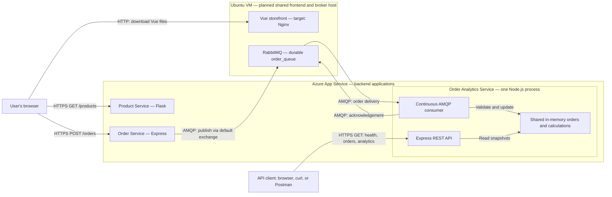

# CST8915 Midterm Project: Order Analytics Service

**Students:** Collin MacLeod, Azubair Dawd, David Yin

**Course:** CST8915 Full-stack Cloud-native Development

**Semester:** Fall 2026

> Review draft — October 18, 2026. Replace every `TODO` and reconcile the planned behavior below with the final source and evidence before submission. This README does not establish that the complete application has passed testing or deployment.

## Introduction

The Order Analytics Service extends the Algonquin Pet Store by processing orders from RabbitMQ and making the resulting data available through a REST API. The intended results include consumed orders, total revenue, average order value, revenue by product, and the top products by quantity sold.

We use Node.js, Express, and amqplib. Our planned design has one continuous queue consumer and one HTTP server sharing the same in-memory state. An order recorded by analytics represents a consumed order message; it does not establish payment, shipping, or fulfillment.

### Current implementation status

Source inspected on branch `readme-update`, based on commit `aa685ae`:

| Area | Current evidence |
| --- | --- |
| Runtime and dependencies | Node.js 24.22.0 and npm 11.19.1 were verified locally during setup; Express, amqplib, and dotenv loaded successfully. |
| Startup | `npm start` runs the root `index.js`. |
| Health route | `index.js` defines `GET /health`; runtime verification for this revision is still pending. |
| RabbitMQ and analytics | No consumer, order state, or analytics routes are present in the inspected source. |
| Automated tests | No test files or `npm test` script are present in this revision. |
| Full application | Local and Azure order-to-analytics demonstrations are pending. |

TODO: Update this table against the final submitted revision; remove superseded draft notes after checking the evidence.

## Demo Video

**Unlisted YouTube video:** TODO: Insert the final video link.

The presentation will show the design and messaging rationale, local and Azure order-to-analytics demonstrations, and the deployed architecture. All three members will present. Target length: 5–10 minutes; recording tool: OBS Studio. See the [assignment presentation instructions](https://github.com/ramymohamed10/26F_CST8915_Midterm_Project#video-presentation).

## Service Overview and Repositories

| Component | Implementation | Repository | Role |
| --- | --- | --- | --- |
| Storefront | Vue.js | [Storefront source](https://github.com/macl0379/store-front) | Displays products and submits orders. |
| Product Service | Python / Flask | [Product Service — midterm-project branch](https://github.com/yanky65/CST8915-lab02-product-service/tree/midterm-project) | Exposes the product catalog. |
| Order Service | Node.js / Express | [Order Service source](https://github.com/ZubairD25/order-service.git) | Receives orders and publishes messages. |
| Order Analytics Service | Node.js / Express / amqplib | [This repository](https://github.com/macl0379/order-analytics-service) | Intended to consume orders and serve analytics. |
| RabbitMQ | Message broker | Not an application repository | Buffers orders in durable `order_queue`. |

The repository links above were confirmed by David. The analytics repository is the group's submission repository. Product Service uses the `midterm-project` branch.

TODO: Record the deployment branch and final commit for each service. This README is being edited on `readme-update`, which is not automatically a deployment branch.

## RabbitMQ Messaging Pattern

### Planned choice: one continuous queue consumer

The existing Order Service sends messages through RabbitMQ's default exchange to `order_queue`. The analytics process will register one `channel.consume()` callback. RabbitMQ pushes available deliveries to that callback while the process remains connected; HTTP requests do not fetch messages from the queue. This follows RabbitMQ's [JavaScript receiving tutorial](https://www.rabbitmq.com/tutorials/tutorial-one-javascript#receiving).

This queue-based design fits the current need: one analytics service must process the orders already published by the existing service. It preserves the publisher's routing and avoids adding a new exchange or a browser connection requirement. Multiple consumers on the same queue would share deliveries, rather than each receiving a copy. Fanout pub/sub would become useful if independent services each needed every order, with a separate queue per service. See RabbitMQ's [work queue](https://www.rabbitmq.com/tutorials/tutorial-two-javascript) and [publish/subscribe](https://www.rabbitmq.com/tutorials/tutorial-three-javascript) explanations.

### Proposed processing sequence

1. Open an AMQP connection and channel using environment configuration.
2. Declare `order_queue` with `{ durable: true }`, matching the publisher. Do not add incompatible queue arguments from a tutorial.
3. Set `prefetch(1)` and register the consumer with `{ noAck: false }`.
4. Decode and validate each order, then update the shared state.
5. Acknowledge the delivery on its receiving channel after successful processing.

The publisher already requests persistent messages and publisher confirms. Queue durability, message persistence, and consumer acknowledgements address different stages of delivery. Publisher confirms do not prove that analytics processed an order. See [RabbitMQ acknowledgements and confirms](https://www.rabbitmq.com/docs/confirms).

TODO: Implement and verify the sequence. Record the final policies for invalid messages, connection/channel failures, consumer cancellation, and graceful shutdown. The proposed invalid-input policy is rejection without requeue; without a dead-letter destination this discards the message, so the group must review and document that choice.

### Storage and delivery limits

The proposed state is held in memory in one application instance and one Node.js process. All routes and the consumer must use the same state object. Restarting clears the stored analytics. Acknowledged messages leave the queue and cannot rebuild that lost state. These limits are permitted by the [assignment's storage expectations](https://github.com/ramymohamed10/26F_CST8915_Midterm_Project#storage-and-restart-expectations).

Unacknowledged messages can be redelivered after connection loss. Updating memory and acknowledging a message are separate operations, so this design does not guarantee exactly-once processing. The existing payload has no stable order identifier for reliable deduplication. WebSockets are outside the current design; the required results are exposed through HTTP GET routes.

## Architecture

The following is the intended Azure topology, including the frontend VM alternative. It must be reconciled with the actual deployed resources before submission.



The browser calls the backend APIs directly after downloading the frontend. The Order Service publishes to RabbitMQ; analytics consumes independently and exposes its current state to API clients.

### Frontend hosting exception

Static Web Apps is unavailable in the team's Azure for Students subscription. David reports that the instructor-approved frontend VM alternative from Lab 3 also applies to this midterm. The intended frontend host is Nginx on the RabbitMQ VM; backend applications remain on App Service.

TODO: Retain the instructor approval as supporting evidence, confirm whether the deployed frontend uses Nginx or the development server, and record the actual frontend CI/CD procedure. The hosting exception alone does not establish an exception to frontend CI/CD.

## API Contract

These are the [required routes](https://github.com/ramymohamed10/26F_CST8915_Midterm_Project#part-1-build-the-order-analytics-service). Only `/health` is currently defined in the inspected code.

| Method | Path | Response content | Status in this revision |
| --- | --- | --- | --- |
| GET | `/health` | Service status | Route defined; broker status not checked. |
| GET | `/orders` | All consumed orders since startup | Pending. |
| GET | `/analytics/summary` | `totalOrders`, `totalRevenue`, `averageOrderValue` | Pending. |
| GET | `/analytics/products` | `productName`, `orderCount`, `totalRevenue` per product | Pending. |
| GET | `/analytics/top-products` | Up to three `productName`, `totalQuantity` entries | Pending. |

The current health handler returns:

```json
{
  "status": "healthy",
  "service": "order-analytics-service"
}
```

This response currently describes only the HTTP handler; it does not verify RabbitMQ connectivity. TODO: Update this documentation if health semantics change.

### Order message and calculation rules

Example message for two units of Dog Food:

```json
{
  "product": { "id": 1, "name": "Dog Food", "price": 19.99 },
  "quantity": 2,
  "totalPrice": 39.98
}
```

Proposed application rules, pending implementation and tests:

- One accepted message counts as one order, regardless of quantity.
- Revenue adds the validated line total once; it does not multiply `totalPrice` by quantity again.
- Average order value is revenue divided by order count, rounded to cents; the empty result is zero.
- Product groups count orders and sum revenue; top products rank by summed quantity.
- Require numeric finite values and a positive integer quantity. Calculate monetary aggregates in integer cents and return money as JSON numbers.

TODO: Record the final rules for price/total consistency, rounding, invalid input, name grouping, and ranking ties. Do not describe proposed validation as implemented behavior.

## Configuration and Local Startup

### Prerequisites

Use Node.js 24 LTS and npm. RabbitMQ plus the other three application services are needed for the complete integration run. On Windows, `npm.cmd` avoids ambiguity with PowerShell's npm script wrapper. Node installed on Windows does not configure a separate Ubuntu VM.

| Variable | Current behavior / intended use |
| --- | --- |
| `PORT` | Implemented in `index.js`; defaults to `4000`. Use the platform-provided port on App Service. |
| `RABBITMQ_CONNECTION_STRING` | Proposed consumer setting, consistent with the reused Order Service. Not currently read by analytics. |

`dotenv` is loaded by the current entrypoint, so a local ignored `.env` can provide `PORT`. The proposed broker value has this shape: `amqp://<user>:<password>@<host>:5672/<vhost>`. Use the same broker/vhost as the publisher and do not commit real credentials. TODO: Align the final consumer variable name; earlier design notes also used `RABBITMQ_URL`.

### Windows PowerShell — current HTTP scaffold

Run from the cloned analytics repository:

```powershell
node --version
npm.cmd ci
$env:PORT = '4000'
npm.cmd start
```

In a second PowerShell terminal:

```powershell
Invoke-RestMethod 'http://localhost:4000/health'
```

### Ubuntu Bash — current HTTP scaffold

Run from the cloned analytics repository:

```bash
node --version
npm ci
PORT=4000 npm start
```

In a second Ubuntu terminal:

```bash
curl --fail http://localhost:4000/health
```

Stop the foreground process with Ctrl+C. These commands exercise the current HTTP scaffold only. TODO: Add the actual broker configuration and full-stack startup commands after the consumer exists.

## Verification and Evidence

### Known-order acceptance example

The following is a proposed test dataset, not observed analytics output. Use a fresh dedicated test broker/vhost or an explicitly recorded baseline; do not purge a shared queue. Start analytics once, then submit these orders through the storefront.

| Order | Product | Unit price | Quantity | Expected line total |
| --- | --- | --- | --- | --- |
| 1 | Dog Food | 19.99 | 1 | 19.99 |
| 2 | Cat Food | 34.99 | 2 | 69.98 |
| 3 | Dog Food | 19.99 | 3 | 59.97 |
| 4 | Bird Seeds | 10.99 | 5 | 54.95 |
| 5 | Cat Food | 34.99 | 1 | 34.99 |

Expected summary: **5 orders**, **239.88 revenue**, **47.98 average order value**.

| Product | Order count | Revenue | Total quantity |
| --- | --- | --- | --- |
| Bird Seeds | 1 | 54.95 | 5 |
| Dog Food | 2 | 79.96 | 4 |
| Cat Food | 2 | 104.97 | 3 |

The top-products ranking should therefore be Bird Seeds, Dog Food, then Cat Food. Also verify an empty dataset, malformed JSON, invalid values, rounding, and acknowledgement behavior. Automated tests support these checks but do not replace a real browser-to-broker integration run.

### Evidence record

| Check | Result currently supported | Evidence to add |
| --- | --- | --- |
| Local dependency setup | Node 24.22.0 and module loading previously verified | Capture runtime and final source revision. |
| Current health handler | Present in source; not executed during this README update | Record HTTP response and date. |
| Automated analytics tests | Not implemented in inspected revision | Add real test command, result, and assertions covered. |
| Local full-stack run | Pending | Browser request JSON/types, broker state, all analytics responses, source commits. |
| Product Service on Azure | `/products` returned HTTP 200 on October 18, 2026 | [Deployment run](https://github.com/yanky65/CST8915-lab02-product-service/actions/runs/39156213130); recheck before recording. |
| Storefront correction | David reported the URL configuration issue resolved | Capture a successful current browser catalog request. |
| Azure order-to-analytics run | Pending | Same known-order checks against deployed services and matching revisions. |

TODO: Link the final screenshots/logs or video timestamps from this repository. A successful workflow alone does not prove that the running service processes orders correctly. Record when checks occurred; public addresses and resources can change.

## Azure Deployment

**Resource group:** `CST8915-Midterm-Project`

**Subscription:** Azure for Students

| Component | Hosting / address currently recorded | Verification status |
| --- | --- | --- |
| Product Service | App Service `product-service-mp`; [GET /products](https://product-service-mp-e8cmescacqfnc2ay.swedencentral-01.azurewebsites.net/products) | Verified October 18; David reported upgrading F1 to B1 after quota exhaustion. |
| Order Service | App Service; [recorded base URL](https://order-service-mp-exgrfra3dufjddd7.swedencentral-01.azurewebsites.net) | End-to-end verification pending. |
| Storefront | [Reported VM address](http://51.12.48.232:8080/) | David reports URL fix; final hosting/CI/CD evidence pending. |
| RabbitMQ | Ubuntu VM; AMQP connection kept in backend settings | TODO: Record VM resource name and network configuration without credentials. |
| Analytics | Intended App Service with Node.js 24 and one instance/process | TODO: Record Web App name, public URL, deployment workflow and successful checks. |

For analytics deployment, package the root `package.json`, lockfile, `index.js`, and any implemented modules. Install dependencies on the deployment platform and start with `npm start`. Supply the final broker setting through App Service configuration and ensure the VM permits the application's AMQP traffic. TODO: Record actual runtime, settings, identity/workflow branch, and deployment evidence after validation.

Frontend `VUE_APP_PRODUCT_SERVICE_URL` and `VUE_APP_ORDER_SERVICE_URL` values must include `https://` for these App Service APIs. Supply them before starting the Vue development server or building the production bundle. The team corrected missing URL schemes during setup. See [Vue CLI environment configuration](https://cli.vuejs.org/guide/mode-and-env.html).

## First Four Twelve-Factor Principles

The [Twelve-Factor App](https://12factor.net/) provides the basis for these implementation checks.

| Factor | Application to this project | Current status |
| --- | --- | --- |
| I. Codebase | Separate analytics Git repository with reviewed changes. | Repository exists. |
| II. Dependencies | Declare libraries in `package.json`; reproduce installs using the lockfile. | Manifest and lockfile exist; direct dependency specifications agree. |
| III. Config | Supply the port and broker connection through environment variables. | Port implemented; broker configuration pending. |
| IV. Backing services | Treat RabbitMQ as an attached service selected through configuration. | Planned; consumer integration pending. |

## Team Contributions

Record completed work rather than the earlier proposed role split. All members are expected to understand the complete system and present their contributions.

| Member | Work currently recorded | Final contribution evidence |
| --- | --- | --- |
| Collin MacLeod | Name supplied in the existing team README. | TODO: Describe completed work and link relevant commits/PRs and presentation segment. |
| Azubair Dawd | Name supplied in the existing team README. | TODO: Describe completed work and link relevant commits/PRs and presentation segment. |
| David Yin (`yanky65`) | Configured Product Service deployment, addressed hosting quota and deployment branch settings, and coordinated setup/troubleshooting. | TODO: Add relevant commits/PRs and presentation segment; reconcile with team review. |

TODO: Confirm name spelling, GitHub usernames, and each member's actual contributions. This draft does not assign ownership or attribute unidentified teammates' work.

## AI Assistance and Student Review

David used OpenAI Codex to assist with assignment analysis, inspection of reused lab code, architecture research, Node.js setup checks, deployment/frontend troubleshooting, proposed acceptance data, and drafting this README. Codex consulted the assignment and official RabbitMQ documentation. No analytics consumer or calculation implementation was generated by Codex as part of this README edit.

The code and deployment claims above were separated from proposed behavior. The group must independently review and modify this draft, verify calculations and application behavior, and explain its design decisions. Student review has not been asserted complete.

**AI citation:** OpenAI. (2026, October 18). *Codex assistance with the CST8915 midterm project* [AI-assisted analysis, troubleshooting, and documentation]. Private working session with David Yin; no public transcript link is provided. TODO: Adapt to any course-specific citation format, add later AI use, and record the group's actual evaluation and changes.

TODO: Before submission, document what the students corrected, rejected, tested, or rewrote, and disclose any additional tools used by other members. Follow the [assignment's academic-integrity requirements](https://github.com/ramymohamed10/26F_CST8915_Midterm_Project#academic-integrity).

## Submission Review

Use the [current assignment](https://github.com/ramymohamed10/26F_CST8915_Midterm_Project) and Brightspace as the authority. The published due date is October 23, 2026; confirm the exact Eastern time in Brightspace.

- [ ] Replace all `TODO` entries and reconcile this draft with the final code and deployment.
- [ ] Confirm the analytics repository is private and `ramymohamed10` has collaborator access.
- [ ] Include source, deployment evidence, final diagram, working video link, and actual contributions.
- [ ] Verify local and Azure demonstrations and the AI disclosure.
- [ ] Merge reviewed documentation into the revision being submitted and submit the repository URL through Brightspace.
- [ ] If the repository changes after submission, follow the assignment's resubmission instructions.
