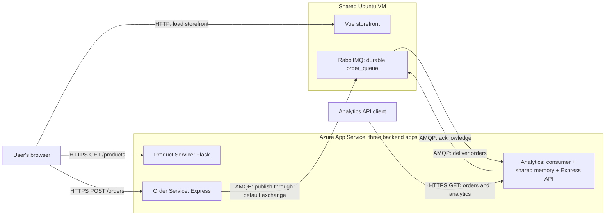

# Order Analytics Service

**CST8915 — Full-stack Cloud-native Development | Fall 2026**

**Team:** Collin MacLeod, Azubair Dawd, David Yin

Extends the Algonquin Pet Store with a continuous RabbitMQ consumer and a REST API for order analytics. Built with Node.js 24, Express, and amqplib, reusing the Order Service's JavaScript stack.

**[Watch the demo](https://youtu.be/BONmHo0WrdY)** · [Assignment](https://github.com/ramymohamed10/26F_CST8915_Midterm_Project)

## Service repositories

| Service | Repository |
| --- | --- |
| Storefront — Vue | [macl0379/store-front](https://github.com/macl0379/store-front) |
| Product Service — Flask | [yanky65/CST8915-lab02-product-service, midterm-project branch](https://github.com/yanky65/CST8915-lab02-product-service/tree/midterm-project) |
| Order Service — Express | [ZubairD25/order-service](https://github.com/ZubairD25/order-service) |
| Order Analytics Service — Express | [macl0379/order-analytics-service](https://github.com/macl0379/order-analytics-service) |

## Architecture



Static Web Apps is unavailable in our Azure for Students subscription. We use the instructor-approved VM hosting alternative: the storefront and RabbitMQ share one Ubuntu VM; all three backend services use App Service.

### Consumer pattern

We use one continuous work-queue consumer on `order_queue`, declared with `durable: true` to match the publisher. RabbitMQ delivers messages through `channel.consume()`. The receiver parses JSON, rounds numeric `totalPrice` values to cents, stores each order, and manually acknowledges it. Processing errors are rejected without requeue.

This fits the existing publisher and one analytics service. Multiple consumers on this queue would share orders; independent subscribers needing every order would require separate queues. HTTP requests read accumulated results and do not trigger consumption. See RabbitMQ's [work queues tutorial](https://www.rabbitmq.com/tutorials/tutorial-two-javascript).

`index.js` starts the consumer and serves the routes; `receiver.js` handles messages; `orders.js` exports their shared array. Run **one application instance and one Node.js process**. Restarting clears analytics, and acknowledged messages cannot be replayed from the queue. `/health` reports HTTP service status, without checking broker connectivity.

## API

All routes use `GET`.

| Endpoint | Response |
| --- | --- |
| `/health` | Service name and status |
| `/orders` | Orders consumed since startup |
| `/analytics/summary` | `totalOrders`, `totalRevenue`, `averageOrderValue` |
| `/analytics/products` | Per-product `productName`, `orderCount`, `totalRevenue` |
| `/analytics/top-products` | Up to three products ranked by `totalQuantity`, descending |

`orderCount` counts order messages, while `totalQuantity` counts units sold. Revenue sums each order's `totalPrice`; average order value divides revenue by order count. Empty summary values are zero. Monetary results are rounded to cents and returned as JSON numbers, so trailing zeroes may be omitted.

## Run locally

Install Node.js 24 LTS and start RabbitMQ. From this repository, create an ignored `.env` file:

```dotenv
PORT=4000
RABBITMQ_CONNECTION_STRING=amqp://<user>:<password>@<host>:5672/<vhost>
```

Replace the placeholders with your broker settings. Use the same broker and virtual host as the Order Service; keep credentials out of Git.

**Windows PowerShell:**

```powershell
npm.cmd ci
npm.cmd start
```

**Ubuntu Bash:**

```bash
npm ci
npm start
```

Start the Product Service, Order Service, and storefront using their repository instructions. Place orders through the storefront, then visit `http://localhost:4000/orders` and the analytics routes. Compare order counts, revenue, and quantities with the submitted orders. Avoid running another analytics consumer against the same queue during this check.

## Azure deployment

**Resource group:** `CST8915-Midterm-Project` · **Subscription:** Azure for Students

| Service | Address |
| --- | --- |
| Storefront | [Open storefront](http://51.12.48.232:8080/) |
| Product Service | [GET /products](https://product-service-mp-e8cmescacqfnc2ay.swedencentral-01.azurewebsites.net/products) |
| Order Service | [Service URL](https://order-service-mp-exgrfra3dufjddd7.swedencentral-01.azurewebsites.net) |
| Order Analytics Service | [GET /health](https://order-analytics-service-hqdma3cmhadyhka2.swedencentral-01.azurewebsites.net/health) · [GET /analytics/summary](https://order-analytics-service-hqdma3cmhadyhka2.swedencentral-01.azurewebsites.net/analytics/summary) |

The [analytics GitHub Actions workflow](.github/workflows/main_order-analytics-service.yml) targets the `order-analytics-service` Web App on pushes to `main` or manual dispatch, using Node.js 24 and Azure OIDC authentication. Configure `RABBITMQ_CONNECTION_STRING` in App Service and start with `npm start`; the application reads the platform's `PORT`.

The first four [Twelve-Factor principles](https://12factor.net/) are reflected in a separate codebase, dependencies declared in `package.json` with a lockfile, environment-based configuration, and RabbitMQ attached through a connection string.

## Contributions

| Member | Contributions |
| --- | --- |
| Collin MacLeod (`macl0379`) | RabbitMQ receiver implementation, consumer startup integration, and analytics Azure deployment workflow. |
| Azubair Dawd (`ZubairD25`) | Orders, summary, product grouping, and top-products endpoints. |
| David Yin (`yanky65`) | Product Service Azure deployment and troubleshooting, monetary rounding adjustment, README and demo preparation, and recording/upload coordination. |

## AI assistance

OpenAI ChatGPT assisted with code in `index.js` and `receiver.js`, as disclosed in those files. OpenAI Codex assisted with assignment analysis, architecture research, environment and deployment troubleshooting, the rounding change, documentation, and demo scripts.

David chose to retain the working design and limit the final code adjustment to monetary rounding. Codex checked sample calculations, rounded numeric values, and public API responses; isolated mocked checks were not full integration tests. This repository has no automated test suite. The group must evaluate the final code and documentation and be able to explain the implementation.

**Citations:** OpenAI. (2026). *ChatGPT* [Generative AI assistance with service code]. OpenAI. (2026, October 18–19). *Codex* [AI-assisted analysis, troubleshooting, code adjustment, and documentation; working session with David Yin].
